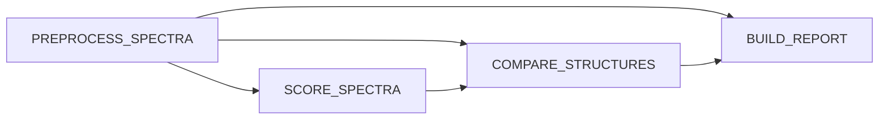

# MS/MS similarity workflow

A Reproducible Nextflow Workflow for Comparing MS/MS Spectral Similarity with Molecular Structural Similarity

## Background

MS/MS breaks a small molecule ion into fragments. Researchers compare the fragment pattern with reference spectra to suggest an identity or find related molecules. Different structures can produce similar fragments. This workflow uses compounds with known structures to check how well spectral scores reflect structural similarity and when a high score may give a poor lead. [Example of spectrum-based annotation](https://doi.org/10.1038/nbt.3597)

## Workflow design

- **Ordinary Cosine** gives a baseline by matching peaks at the same or nearly the same m/z.
- **Modified Cosine** also allows a shift based on the difference in precursor m/z. This tests whether shifted matches give a better clue about structure.
- **Morgan fingerprints and Tanimoto** give a separate 2D structure score. RDKit encodes local parts of each molecule as bits, and Tanimoto measures how many bits the molecules share relative to the total set across both.
- **Nextflow** passes files between steps, runs each step in the same Docker environment, and can reuse completed steps when a run resumes.

## Pipeline DAG

Each arrow points from the step that produces data to the step that uses it. The comparison and report both use output from preprocessing.



| Step                 | Main inputs                                                    | What it does                                                                                                  | Main outputs under `results/`                                    |
| -------------------- | -------------------------------------------------------------- | ------------------------------------------------------------------------------------------------------------- | ---------------------------------------------------------------- |
| `PREPROCESS_SPECTRA` | Raw MassBank files, `data/manifest.json`, `params.json`        | Verify files, check conditions and structures, filter and normalize peaks, and keep one record per structure. | `preprocess/` with `spectra.json` and QC tables                  |
| `SCORE_SPECTRA`      | Clean spectra, `params.json`                                   | Compute both Cosine scores and count matched peaks for each pair.                                             | `scores/spectral_scores.csv`                                     |
| `COMPARE_STRUCTURES` | Structures from `spectra.json`, spectral scores, `params.json` | Compute Tanimoto, merge the scores, summarize the results, and select two cases.                              | `comparison/` with `pairs.csv`, `summary.json`, and `cases.json` |
| `BUILD_REPORT`       | Preprocessing and comparison outputs                           | Draw scatter plots, mirror spectra, and 2D structures. Combine them with QC and score tables.                 | `report/report.html`, PNG figures, and tables                    |

## Setup

Use Linux or WSL2 on Windows, Java 17, Docker, and Nextflow 24.10.4.
Start Docker. On Windows, enable integration for your WSL distribution. [Docker Desktop WSL 2 setup](https://docs.docker.com/desktop/features/wsl/)

In a Linux or WSL terminal, check Java and Docker.

```bash
java -version
docker --version
docker info
```

Java should show version 17. `docker info` should show a running Linux server.

Install and check Nextflow in the project folder.

```bash
export NXF_VER=24.10.4
curl -fsSL https://get.nextflow.io | bash
./nextflow -version
```

Nextflow should show version 24.10.4.

Docker installs the analysis tools. All Python package versions are pinned in [requirements.lock.txt](requirements.lock.txt).

| Tool       | Version  |
| ---------- | -------- |
| Python     | 3.11.11  |
| matchms    | 0.28.2   |
| RDKit      | 2024.9.6 |
| pandas     | 2.2.3    |
| matplotlib | 3.9.4    |
| NumPy      | 1.26.4   |
| SciPy      | 1.14.1   |

## Run

```bash
docker build -t biof501-msms:1.0 .
./nextflow run main.nf
```

Open `results/report/report.html` in a browser. It works offline.
Use `./nextflow run main.nf -resume` to reuse completed tasks.
Keep the same Docker image for resume. After changing the image, run without `-resume`.
No data download is needed. Internet is needed for the first software setup.

One task runs at a time, with one CPU and a 2 GB memory limit.
An 8 GB computer with about 5 GB free space is a practical setup for Docker and Java.
No GPU is needed. The tested platform is Linux x86_64 through WSL2.

## Results

- 65 raw records; 58 pass conditions; 38 unique structures; 703 pairs.
- Pearson r: Cosine 0.446; Modified Cosine 0.679.
- Spearman rho: Cosine 0.086; Modified Cosine 0.222.
- Higher spectral scores do not always mean similar structures.

The sample uses MassBank 2026.03, Athens_Univ, at 20 eV.
The initial 61 / 48 counts were estimates. [Methods](docs/METHODS.md) explains the final selection and filters.

## Check

`expected/` contains the reference output. A fresh run matched all report files. The first check uses Python 3 on the host.

```bash
python3 scripts/check_results.py results/report expected/report
docker run --rm -v "$PWD:/work" -w /work biof501-msms:1.0 python scripts/test_analysis.py
```

For a fresh check, use a clean copy of the project and follow Setup, Run, and Check.

## Files

- `data/`: raw records, source URLs, hashes, and attribution.
- `scripts/`, `main.nf`, `nextflow.config`: analysis code.
- `params.json`, `Dockerfile`, `requirements.lock.txt`: fixed settings and environment.
- `expected/report/`: all pair scores, QC, figures, cases, and HTML report.
- `docs/VALIDATION.md`: run evidence and limits.
